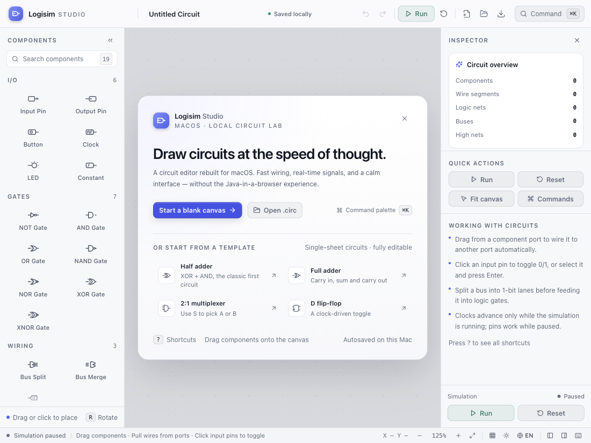
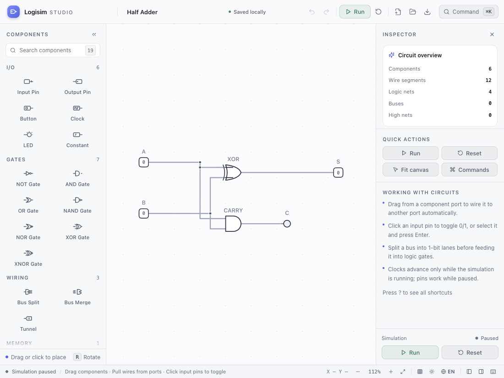
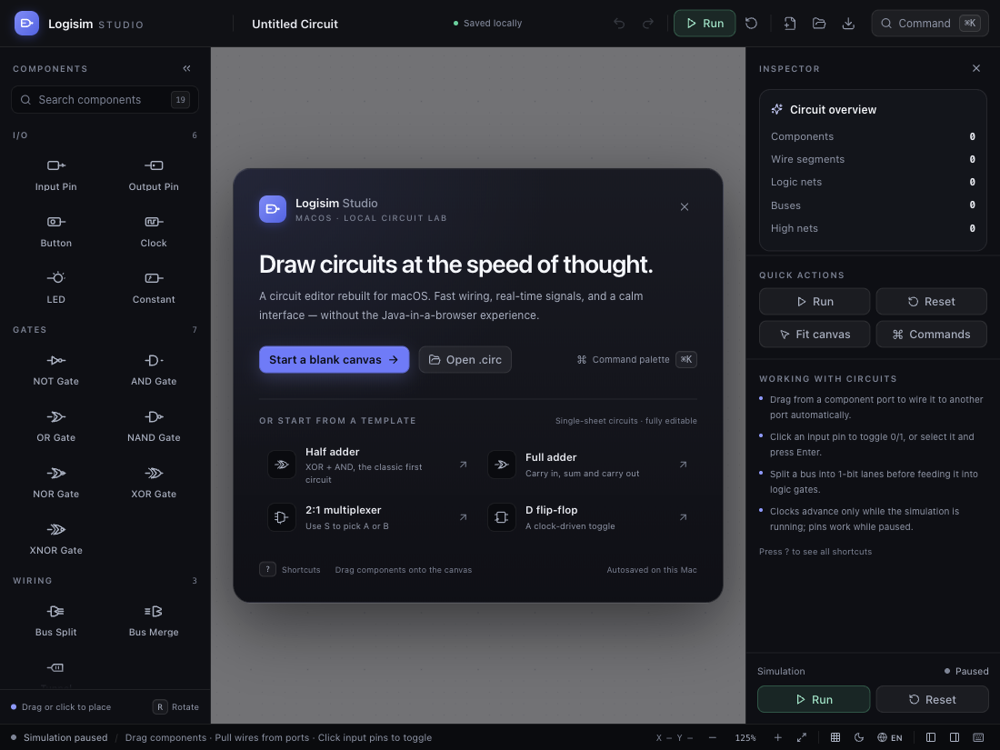

# Logisim Studio

> 一个为 macOS 重新设计的数字电路编辑器。不是把 Java Logisim 塞进浏览器，而是把画电路这件事重新做顺手。



<sub>浅色英文界面 · 深色英文界面见文末</sub>

## 为什么

经典 Logisim 很好用，但 `logisim.app` 那套 CheerpJ + Java Swing 的网页版体验太糟糕：拖拽迟滞、快捷键冲突、缩放发糊、窗口像 2003 年。

这是一个从零写的本地 Web 编辑器，目标很明确：

- 画布拖拽和连线跟手
- 键盘优先，⌘ 系快捷键完整
- 实时仿真，信号用颜色和流动动画表达
- 支持总线、触发器、多路选择器和隧道标签
- 自动保存，不需要账号和服务器
- macOS 触控板手势、浅色/深色界面、系统字体

## 功能

- **顺手的画布**：拖拽移动、框选、网格吸附、方向键微调、撤销/重做
- **智能连线**：从任意端口拖出导线，自动绕开元件，正交布线；可以落在已有导线上形成 T 型分支
- **完整快捷键**：`V` 选择、`W` 连线、`H` 手形、`R` 旋转、`⌘K` 命令面板、`Space` 拖动画布
- **实时仿真**：组合逻辑即时收敛，D 触发器按时钟沿更新，时钟只在运行时推进
- **总线**：分线器 / 合线器，多 bit 引脚，运行时直接编辑总线值
- **元件**：输入/输出引脚、按钮、时钟、LED、常量、7 种门、分线/合线、隧道标签、D 触发器、多路选择器、文字注释
- **现代界面**：English / 中文；System / Light / Dark 外观；Paper / Graphite 画布；命令面板、属性检查器、右键菜单、Toast、快捷键面板、首启动欢迎页
- **完整本地化**：所有按钮、提示、菜单、快捷键说明与 Toast 均随语言切换；英文界面为默认回退
- **浅色与深色**：状态栏右侧的外观与语言控件；可在浅色界面搭配 Paper 画布，或深色界面搭配 Graphite 画布；偏好本地持久化
- **本地优先**：localStorage 自动保存、项目 JSON 导入导出、经典 Logisim `.circ` 实验性导入导出
- **macOS 细节**：⌘ 快捷键、触控板双指平移/捏合缩放、`Space` 拖拽、SF 字体、Retina 渲染



## 运行

需要 Node.js 20+。

```bash
npm install
npm run dev
# 打开 http://localhost:5173
```

生产构建：

```bash
npm run build
npm run preview
```

测试：

```bash
npm test
```

首次打开会显示欢迎页；之后状态栏右侧的 **太阳/月亮图标** 打开「外观与语言」，**地球 + EN/中** 一键切换语言。所有设置在 `⌘K` 命令面板中也有对应动作。外观默认跟随 macOS；画布颜色与界面颜色相互独立。

## 快捷键

| 操作 | 快捷键 |
| --- | --- |
| 命令面板 | `⌘K` |
| 选择 / 连线 / 手形 | `V` / `W` / `H` |
| 平移画布 | `Space` + 拖拽，或双指滑动 |
| 缩放 | `⌘` + 滚轮 / 捏合，`⌘+` / `⌘−` |
| 适应画布 | `⌘0` |
| 旋转 | `R` / `⇧R` |
| 撤销 / 重做 | `⌘Z` / `⇧⌘Z` |
| 复制 / 全选 / 删除 | `⌘D` / `⌘A` / `⌫` |
| 微移 | 方向键（`⇧` 为 1 单位） |
| 翻转选中的输入引脚 | `Enter` |
| 运行 / 暂停仿真 | `⌘↩` |
| 打开 / 保存副本 / 导出 `.circ` | `⌘O` / `⌘S` / `⌘E` |
| 快捷键面板 | `?` |

界面：`⌘K` → “Light appearance / Dark appearance / 中文 / English”；状态栏 `EN/中` 直接切换语言。

## `.circ` 兼容性

导入导出是"实验性、够用"的程度，不是 100% 的 Logisim 实现：

**可以导入**：输入/输出引脚、Probe、LED、Button、时钟、常量、隧道标签、NOT/AND/OR/NAND/NOR/XOR/XNOR、D 触发器、多路选择器、文字。

**可以导出**：同上（导出成 Logisim 2.7.1 版本格式），并会统一平移到正坐标。

**暂不支持**：子电路、Splitter、Register、RAM/ROM、ALU、三态、Logisim Evolution 的新元件。

导入时会自动修补端口附近的连线端点；如果文件里有被跳过的元件，会通过 Toast 提示。导出时如果包含分线/合线器，会跳过并提示。导入导出提示均跟随当前界面语言。

经典 Logisim 的 2 输入门默认是 50 宽，本项目导入时会遵循这个几何；自己新建的门也是 50 宽，内置模板为了紧凑使用 30 宽。

## 已知边界

- 没有子电路/模块复用，也没有寄存器、RAM、ALU；适合数字逻辑课程的单页电路
- 多驱动、`Z` 三态和冲突检测没有实现
- 拖动元件时导线不会跟着走（与 Logisim 一致）；需要重新连线
- 仿真模型针对组合逻辑和简单时序电路，不保证复杂反馈电路的波形时序
- 只针对 macOS 的现代浏览器（Safari / Chrome）测试；界面和手势优先 macOS

## 结构

```
src/
  model/       数据类型、元件几何、网络表、仿真器
  editor/      状态与撤销栈、模板、文件读写、.circ 转换
  canvas/      Canvas 渲染与指针交互
  ui/          顶栏、元件库、检查器、状态栏、命令面板、快捷键、右键菜单
```

实现上没有用现成的电路库：网表通过并查集从导线和端口坐标构建，组合逻辑用迭代到不动点的方式求解，时序元件在稳定值上做时钟沿检测。

项目默认只在本地运行，不包含后端，也不会上传任何电路数据。

---

<details>
<summary>深色界面预览</summary>



</details>
